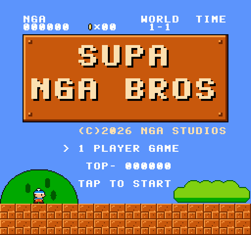
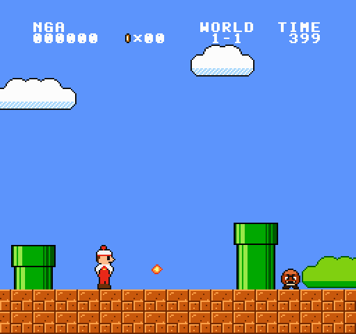
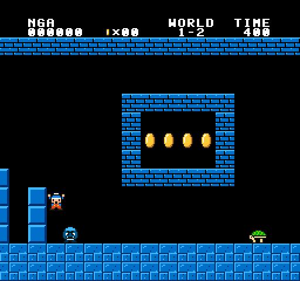
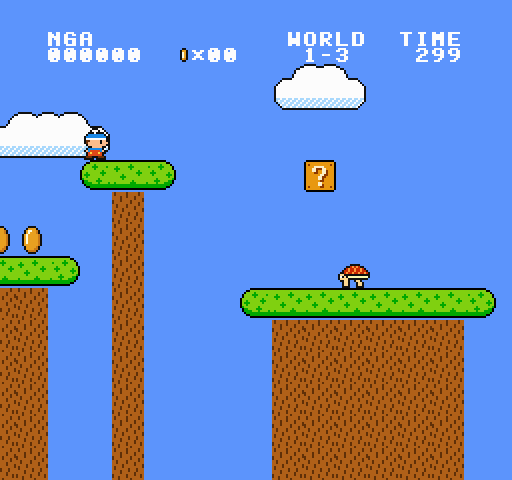
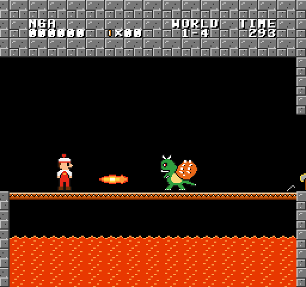
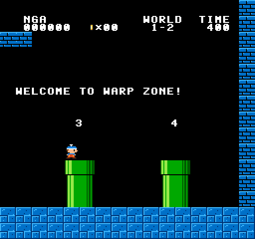
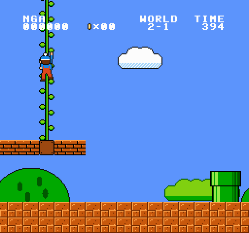
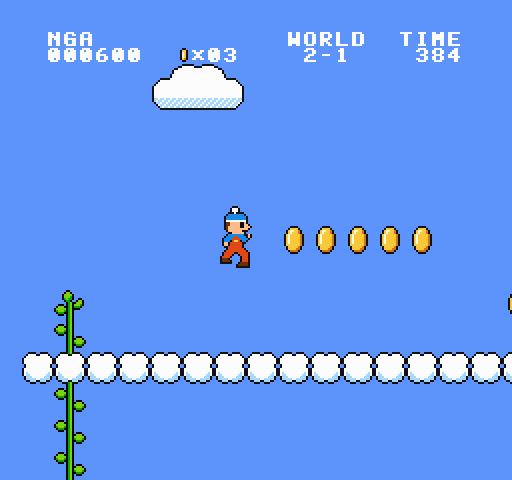
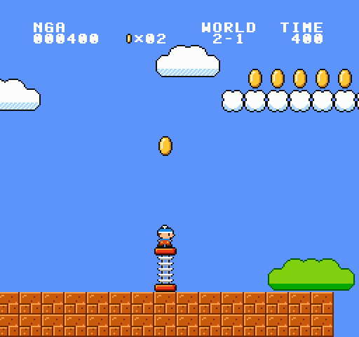

# Supa NGA Bros

Ein klassischer 2D-Jump-'n'-Run für Android im Stil von *Super Mario Bros.* (NES) –
komplett in Kotlin geschrieben, ohne Game-Engine und ohne externe Assets.
Grafik, Musik und Soundeffekte entstehen im Code (eigene Pixel-Art und eigene Chiptune-Melodien).

| Titel | Welt 1-1 | Welt 1-2 |
|---|---|---|
|  |  |  |
| **Welt 1-3** | **Welt 1-4** | **Warp-Zone** |
|  |  |  |
| **Welt 2-1** | **Münzhimmel** | **Sprungfeder** |
|  |  |  |

## Features

- **Original-Feeling:** 256×240-Bild, 60 FPS, Lauf-/Sprungphysik nach dem Vorbild des NES-Klassikers
  (Beschleunigen, Rennen mit B, Bremsen/Schlittern, Sprunghöhe abhängig von Tastendruck und Tempo)
- **Welt 1 mit 4 Leveln:**
  - 1-1 Oberwelt mit verstecktem Bonusraum (Röhre), 1-UP-Block, Treppen, Fahnenmast und Burg
  - 1-2 Untergrund mit Liften, Pflanzen in Röhren und einer geheimen **Warp-Zone** über der Decke
  - 1-3 Baumwipfel hoch über dem Abgrund mit schwingenden und fallenden Plattformen
  - 1-4 Burg mit Lava, Feuerbalken, Lavablasen und dem Feuer speienden Boss auf der Brücke (Axt!)
- **Welt 2** (bisher 2-1): nach der Burg 1-4 geht es weiter
  - 2-1 Oberwelt vor der Burg aus Welt 1, mit Grumpel-Trios, Flug-Schildkröten, einer **Ranke**
    (in einem Ziegel der Brücke versteckt – von unten anstoßen), die in einen **Münzhimmel** über den Wolken führt,
    und einer **Sprungfeder**: normal federn sammelt die Münzen darüber ein, im richtigen Moment A drücken
    katapultiert auf eine Wolkenstraße hoch über den Gegnern
- **Gegner:** Grumpel (zum Draufspringen), Schildkröten (grün, rot, geflügelt) mit kickbarem Panzer,
  Schnappblumen, Lavablasen, Feuerbalken, Boss „Krawallo“
- **Items:** Pilz (groß werden), Feuerblume (Feuerbälle), Stern (unverwundbar), 1-UP-Pilz,
  Münzen, ?-Blöcke, zerbrechliche Steine, Mehrfach-Münzblöcke, versteckte Blöcke, Ranken-Blöcke
- **Punkte wie im Original:** Stampf-Kombos bis zum 1-UP, Panzer-Kombos, Fahnenmast-Bonus nach Höhe,
  Zeitbonus, Feuerwerk (wenn die Restzeit auf 1, 3 oder 6 endet), 100 Münzen = 1-UP, Highscore wird gespeichert
- **Sound:** eigener Chiptune-Synthesizer (2× Puls, Dreieck, Rauschen) mit Oberwelt-, Untergrund-,
  Burg- und Stern-Musik, Jingles und allen Effekten; Musik wird schneller, wenn die Zeit knapp wird
- **Steuerung:** Touch-Steuerkreuz + A/B-Tasten (in den schwarzen Balken neben dem Bild),
  Gamepad und Tastatur werden ebenfalls unterstützt

## Steuerung

| Aktion | Touch | Gamepad | Tastatur |
|---|---|---|---|
| Laufen | Steuerkreuz links | Steuerkreuz / Stick | Pfeiltasten / A, D |
| Ducken / in Röhre | Steuerkreuz unten | unten | ↓ / S |
| Ranke hoch-/runterklettern | Steuerkreuz oben / unten | oben / unten | ↑ / W, ↓ / S |
| Springen (gedrückt halten = höher) | **A** | A | Leertaste / K |
| Rennen / Feuerball | **B** (Daumen zwischen A und B = beides) | B / X / Y | Shift / J |
| Pause | ⏸ oben links | Start | Enter / P |

In Seitenröhren läuft man einfach hinein (rechts drücken), in senkrechte Röhren mit „unten“.
Eine Ranke packt man im Sprung oder mit „oben“; mit links/rechts oder A lässt man wieder los.
Auf der Sprungfeder A drücken, während sie zusammengedrückt wird – dann geht es richtig hoch.

## Installieren & Bauen

Fertige APKs baut der GitHub-Workflow bei jedem Push (Actions → *Build APK* → Artefakt `supa-nga-bros-apk`).

Selbst bauen (Android SDK und JDK 17 nötig, oder einfach in Android Studio öffnen):

```bash
./gradlew assembleRelease            # app/build/outputs/apk/release/app-release.apk
./gradlew installDebug               # direkt auf ein per USB verbundenes Handy
./gradlew testDebugUnitTest          # Tests, rendert Screenshots nach app/build/screenshots
```

Die Release-APK ist zum direkten Installieren mit dem Debug-Schlüssel signiert. Für eine Veröffentlichung
im Play Store muss in `app/build.gradle.kts` eine eigene Signatur eingetragen werden.

## Projektaufbau

```
app/src/main/java/com/supanga/bros/
├── MainActivity.kt, GameView.kt     Android: Vollbild, Game-Loop (60 Hz), Skalierung
├── TouchControls.kt                 Touch-Steuerkreuz und A/B-Tasten
├── AndroidAudio.kt                  AudioTrack-Ausgabe, Highscore-Speicher
└── core/                            plattformunabhängiger Spielkern (reines Kotlin)
    ├── Game.kt                      Zustände, Kamera, Kollisionen, Punkte, HUD, Titelbild
    ├── Player.kt                    Held „Nga“ und seine Physik
    ├── Enemies.kt, Items.kt         Gegner, Power-ups, Feuerbälle, Lifte, Ranken, Sprungfedern
    ├── Level.kt, Levels.kt          Kachelwelt + Level-DSL mit allen Leveln
    ├── Art.kt, Sprites.kt, Gfx.kt   Pixel-Art als ASCII, Paletten, Software-Renderer, Schrift
    └── Audio.kt                     Synthesizer, Musikstücke, Soundeffekte
```

Neue Level lassen sich in `Levels.kt` mit wenigen Zeilen beschreiben, z. B.:

```kotlin
ground(0, 68)                 // Boden von Spalte 0 bis 68
row(20, 9, "BMB?B")           // Steine, Power-up-Block, Münzblock
pipe(28, 2)                   // Röhre, 2 Kacheln hoch
walkers(12, 22)               // Gegner
row(48, 9, "BBBVBB")          // Ziegel mit Ranke (V); C wären Wolkenblöcke
spring(132)                   // Sprungfeder
flag(198); castle(202)        // Fahnenmast und Burg
```

Neue Level kommen in `Levels.names` (Reihenfolge und Anzeige im HUD) und in `Levels.create`.

## Hinweis

Supa NGA Bros ist ein Fan-Projekt, das sich am Spielgefühl des Klassikers orientiert.
Figuren, Pixel-Grafiken, Level und Musik sind eigene Kreationen; es werden keine Original-Assets verwendet.
